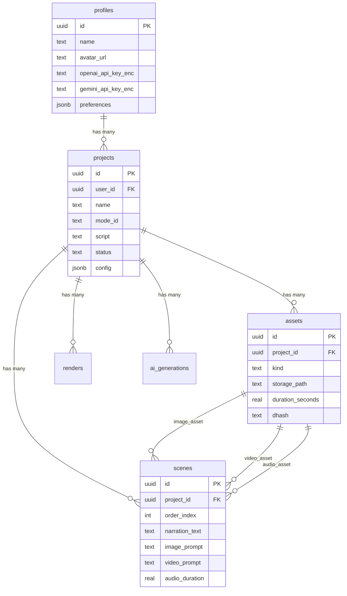

# Video Assembler - Supabase Arsenal Express

**Project ID:** `neuxjrdlzhhfsojjajwy`  
**Region:** us-east-1  
**Database:** PostgreSQL 17  
**Status:** ✅ Schema v2.0 Deployed

---

## 📊 Schema Criado

### Tabelas (6)

| Tabela | Descrição | RLS |
|--------|-----------|-----|
| `profiles` | Perfil do usuário (1:1 com auth.users) | ✅ |
| `projects` | Projetos de vídeo | ✅ |
| `assets` | Imagens, vídeos, áudios | ✅ |
| `scenes` | Cenas do projeto com prompts | ✅ |
| `renders` | Fila de renderização | ✅ |
| `ai_generations` | Histórico de chamadas de IA | ✅ |

### Storage Buckets (2)

| Bucket | Público | Tamanho Máx | Tipos Permitidos |
|--------|---------|-------------|------------------|
| `media` | ❌ Privado | 500 MB | images, videos, audio |
| `renders` | ❌ Privado | 500 MB | videos (MP4, MOV) |

**Path structure:** `{user_id}/{project_id}/{asset_id}.ext`

---

## 🔐 Segurança

### Row Level Security (RLS)

Todas as tabelas têm RLS habilitado:

- **profiles:** Usuário só acessa próprio perfil
- **projects:** Usuário só vê projetos que criou
- **assets/scenes/renders/ai_generations:** Acesso via `projects.user_id`

### Storage Policies

- Usuário só acessa arquivos em pastas com seu `user_id`
- Formato: `/media/{user_id}/{project_id}/file.mp4`

---

## 📝 Migrations

### 001_schema_v2.sql
- ✅ Extensão `pgcrypto`
- ✅ Função `set_updated_at()`
- ✅ Tabelas: profiles, projects, assets, scenes, renders, ai_generations
- ✅ Indexes otimizados
- ✅ RLS policies completas
- ✅ Triggers `updated_at`
- ✅ Storage buckets + policies

---

## 🔑 Variáveis de Ambiente

```bash
# Next.js Frontend
NEXT_PUBLIC_SUPABASE_URL=https://neuxjrdlzhhfsojjajwy.supabase.co
NEXT_PUBLIC_SUPABASE_ANON_KEY=<anon_key>

# FastAPI Backend (Service Role)
SUPABASE_URL=https://neuxjrdlzhhfsojjajwy.supabase.co
SUPABASE_SERVICE_KEY=<service_role_key>
```

⚠️ **Importante:** Service role só no backend! Nunca no frontend.

---

## 📊 Schema Diagram



---

## 🧪 Testar RLS

```sql
-- Como usuário X (via JWT)
select * from projects; -- Vê só seus projetos
select * from profiles where id = auth.uid(); -- Vê só seu perfil

-- Service role (backend) vê tudo
select * from projects; -- Todos os projetos
```

---

## ✅ Status da Fase 1

- [x] Schema v2.0 criado
- [x] RLS policies aplicadas
- [x] Storage buckets configurados
- [x] Triggers de updated_at
- [x] Indexes otimizados
- [ ] **Próximo:** Next.js 15 + Auth

---

**Criado em:** 10/10/2026  
**Por:** Kiro AI Assistant
